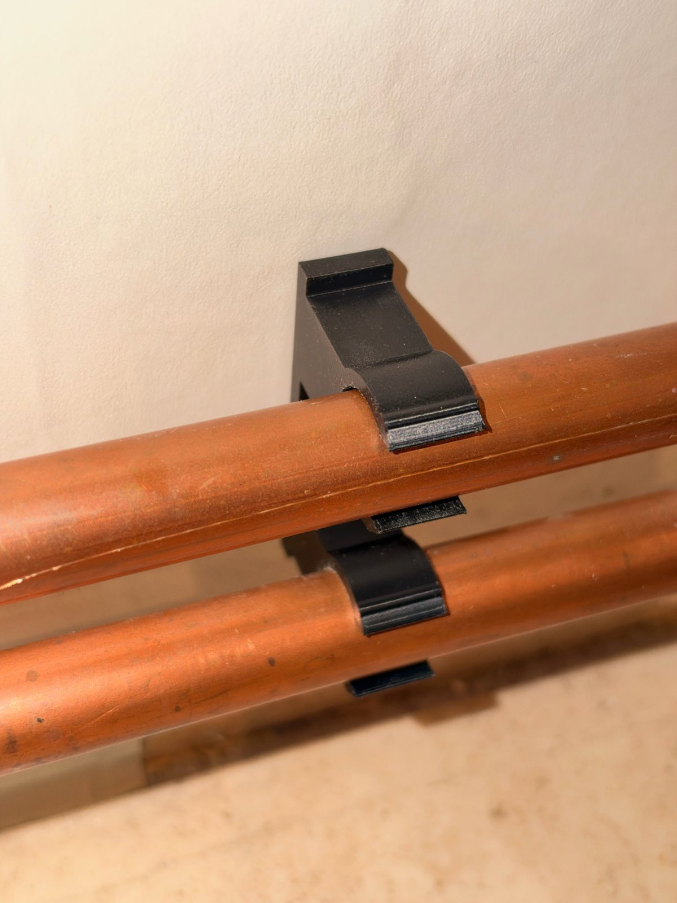
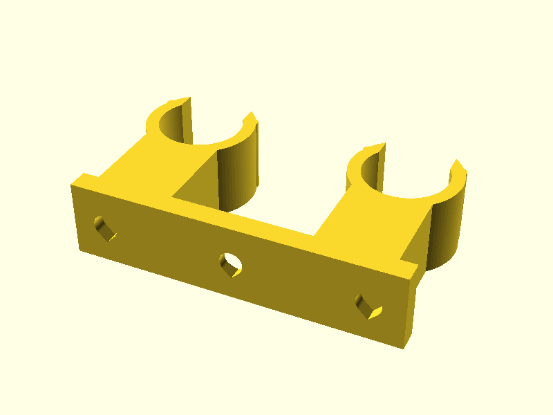
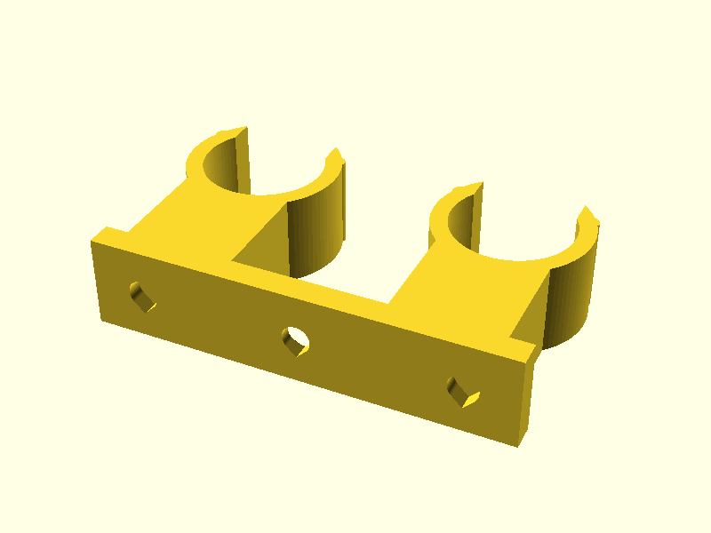
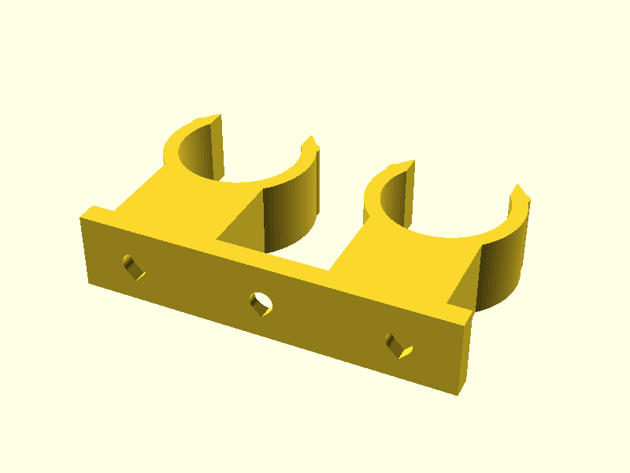
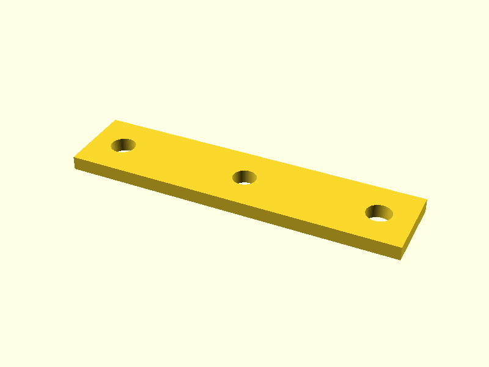
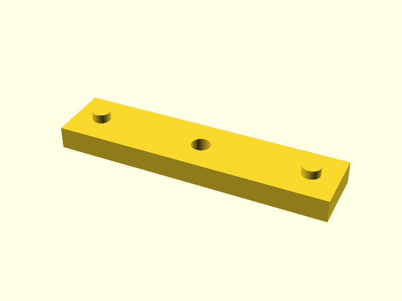
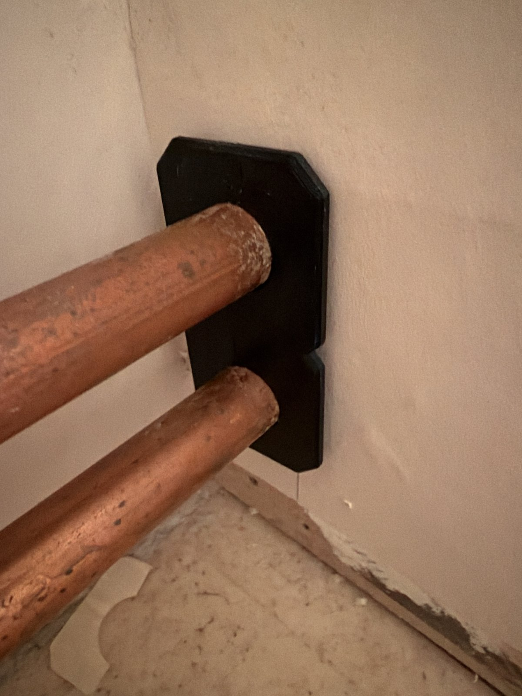

# Radiator Pipe Clips

A parametric **double / twin radiator pipe clip** for OpenSCAD: a back plate with two snap-on C-clips that hold the supply and return pipes of a radiator at a fixed distance from the wall. Optional **stackable spacers** move the clip further out from the wall.

> ✅ **Fit check OK (18 mm twin clip, default parameters).** Jonas test-printed the standard 18 mm clip and it holds on the pipes. The 15 mm and 22 mm clips and the spacers have not been test-printed yet.



## Previews

| 15 mm | 18 mm | 22 mm |
|---|---|---|
|  |  |  |

| Spacer 2.5 mm | Spacer 5 mm |
|---|---|
|  |  |

## STL files

| File | Part | Pipe Ø | Notes |
|---|---|---|---|
| [stl/twin_pipe_clip_15mm.stl](stl/twin_pipe_clip_15mm.stl) | Twin clip | 15 mm | c/c 40 mm, gap 20 mm |
| [stl/twin_pipe_clip_18mm.stl](stl/twin_pipe_clip_18mm.stl) | Twin clip | 18 mm | c/c 40 mm, gap 20 mm |
| [stl/twin_pipe_clip_22mm.stl](stl/twin_pipe_clip_22mm.stl) | Twin clip | 22 mm | c/c 40 mm, gap 20 mm |
| [stl/spacer_2.5mm.stl](stl/spacer_2.5mm.stl) | Spacer | any | 2.5 mm thick, stackable |
| [stl/spacer_5mm.stl](stl/spacer_5mm.stl) | Spacer | any | 5 mm thick, stackable |

## Parameters

All parameters are at the top of [`src/radiator_pipe_clip.scad`](src/radiator_pipe_clip.scad) (comments in the file are in Swedish).

| Parameter | Default | Meaning |
|---|---|---|
| `part` | `"holder"` | `"holder"` for the twin clip, `"spacer"` for a spacer |
| `pipe_d1` | `18` | Diameter of pipe 1 (mm) |
| `pipe_d2` | `18` | Diameter of pipe 2 (mm), can differ from pipe 1 |
| `cc` | `40` | Centre-to-centre distance between the pipes (mm) |
| `gap` | `20` | Distance from the wall to the nearest pipe surface (mm), without spacers |
| `clearance` | `0.3` | Radial play around the pipe (mm) |
| `snap_ratio` | `0.87` | Clip opening width / pipe diameter (lower = tighter snap) |
| `clip_wall` | `2.6` | Wall thickness of the C-clips (mm, tuned for PETG) |
| `width` | `14` | Clip width along the pipe = print height (mm) |
| `base_t` | `4` | Back plate thickness (mm) |
| `base_len` | `60` | Back plate length (mm) |
| `screw_d` / `screw_head_d` | `4.2` / `8.5` | Screw hole and countersink diameter (mm) |
| `spacer_t` | `5` | Spacer thickness (mm), e.g. 2.5 or 5 |
| `spacer_len` | `60` | Spacer length (mm), independent of pipe size |
| `peg_x`, `peg_d`, `peg_h`, `peg_tol`, `pegs` | `24`, `4`, `2`, `0.25`, `true` | Locating pegs; fixed positions so one spacer fits every clip |

### Spacers are stackable

Spacers have locating pegs at fixed positions, so they fit every clip size and stack on each other. Combine 2.5 mm and 5 mm spacers to fine-tune the wall distance (e.g. 2.5 + 5 = 7.5 mm extra).

### Standard copper pipe sizes

Copper pipe (EN 1057) is commonly 10, 12, 15, 18, 22 and 28 mm outer diameter. Set `pipe_d1` / `pipe_d2` to the measured outer diameter of your pipes.

## Wall cover plate

A parametric **wall cover plate (escutcheon)** for where the two radiator pipes come out of the wall: [`src/wall_cover.scad`](src/wall_cover.scad). It is made of **two identical halves**, split through the pipe centres, joined by a dovetail in the seam that slides together along the pipes. Nothing bends, so it is PETG-safe. Print the halves flat, front side up, without supports. Mount it with double-sided tape (flat back, default) or with countersunk wood screws.

> ✅ **Fit check OK.** Jonas test-printed the cover plate (18 mm pipes, c/c 40 mm, width 40 mm) and it fits.



### Cover plate STL files (18 mm pipes, c/c 40 mm, width 40 mm)

`half` = one half (print 2), `print` = both halves laid out together on the bed.

| File | Thickness | Mounting | Part |
|---|---|---|---|
| [wall_cover_18mm_w40_t3_tape_half.stl](stl/wall_cover_18mm_w40_t3_tape_half.stl) | 3 mm | Tape | One half |
| [wall_cover_18mm_w40_t3_tape_print.stl](stl/wall_cover_18mm_w40_t3_tape_print.stl) | 3 mm | Tape | Both halves |
| [wall_cover_18mm_w40_t3_screws_half.stl](stl/wall_cover_18mm_w40_t3_screws_half.stl) | 3 mm | Screws | One half |
| [wall_cover_18mm_w40_t3_screws_print.stl](stl/wall_cover_18mm_w40_t3_screws_print.stl) | 3 mm | Screws | Both halves |
| [wall_cover_18mm_w40_t5_tape_half.stl](stl/wall_cover_18mm_w40_t5_tape_half.stl) | 5 mm | Tape | One half |
| [wall_cover_18mm_w40_t5_tape_print.stl](stl/wall_cover_18mm_w40_t5_tape_print.stl) | 5 mm | Tape | Both halves |
| [wall_cover_18mm_w40_t5_screws_half.stl](stl/wall_cover_18mm_w40_t5_screws_half.stl) | 5 mm | Screws | One half |
| [wall_cover_18mm_w40_t5_screws_print.stl](stl/wall_cover_18mm_w40_t5_screws_print.stl) | 5 mm | Screws | Both halves |

### Cover plate parameters

| Parameter | Default | Meaning |
|---|---|---|
| `part` | `"half"` | `"half"`, `"print"` (both halves), `"assembled"`, `"exploded"` |
| `pipe_preset` / `pipe_d_custom` | `18` / `0` | Pipe diameter: 15, 18 or 22 mm (custom value > 0 overrides) |
| `pipe_clearance` | `0.8` | Extra hole diameter around the pipe (mm) |
| `cc` | `40` | Pipe centre-to-centre distance (same as the clip) |
| `width_preset` / `width_custom` | `40` / `0` | Plate width across the pipes: 40, 50 or 60 mm |
| `height_custom` | `0` | Plate height; default is `cc + width` |
| `thick_preset` / `thick_custom` | `3` / `0` | Plate thickness: 3 or 5 mm |
| `screw_holes` | `false` | `false` = double-sided tape (flat back), `true` = countersunk screw holes |
| `screw_size` | `"ws3.0"` | Wood screw with countersunk head: `ws3.0` = Ø3.3 mm hole, Ø6 mm countersink (also `ws3.5`, `ws4.0`, `M2.5`, `M3.5`) |
| `screw_hole_d_custom` / `screw_head_d_custom` | `0` | Override hole / countersink diameter |
| `waist_notch` | `3` | V-notch at the waist between the pipes (0 = straight) |
| `dt_neck`, `dt_head`, `dt_depth`, `dt_tol` | `3`, `5.5`, `3`, `0.15` | Dovetail joint dimensions and clearance |

```sh
# 5 mm cover with screw holes, both halves on the bed
openscad -o cover.stl -D thick_preset=5 -D screw_holes=true -D 'part="print"' src/wall_cover.scad
```

## Customizing in OpenSCAD

1. Install [OpenSCAD](https://openscad.org/).
2. Open `src/radiator_pipe_clip.scad`.
3. Edit the parameters at the top of the file, or use **Window → Customizer**.
4. Press **F6** to render, then **File → Export → Export as STL**.

From the command line:

```sh
# 22 mm twin clip
openscad -o clip_22.stl -D pipe_d1=22 -D pipe_d2=22 src/radiator_pipe_clip.scad
# 15 mm + 18 mm mixed clip, pipes 45 mm apart
openscad -o clip_15_18.stl -D pipe_d1=15 -D pipe_d2=18 -D cc=45 src/radiator_pipe_clip.scad
# 2.5 mm spacer
openscad -o spacer_2.5.stl -D 'part="spacer"' -D spacer_t=2.5 src/radiator_pipe_clip.scad
```

## Print tips

- **Material:** PETG (tough and slightly flexible, good for snap fits and warm pipes).
- **Perimeters:** 4 walls for strong clip arms.
- **Orientation:** print flat as exported, **no supports** needed.
